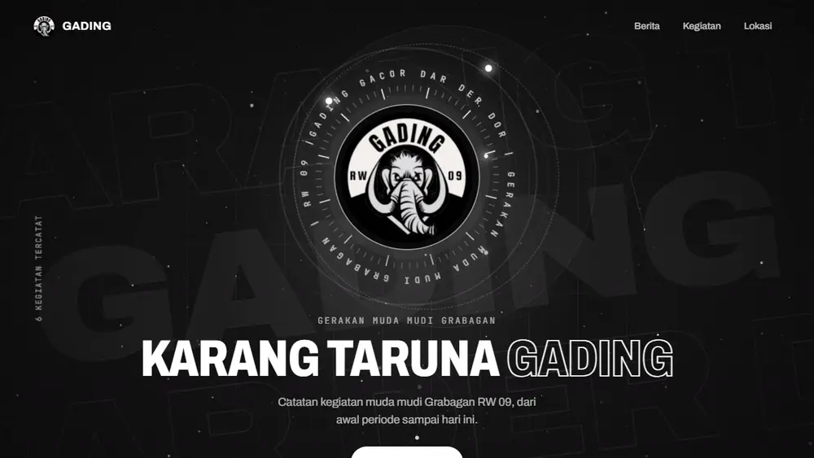
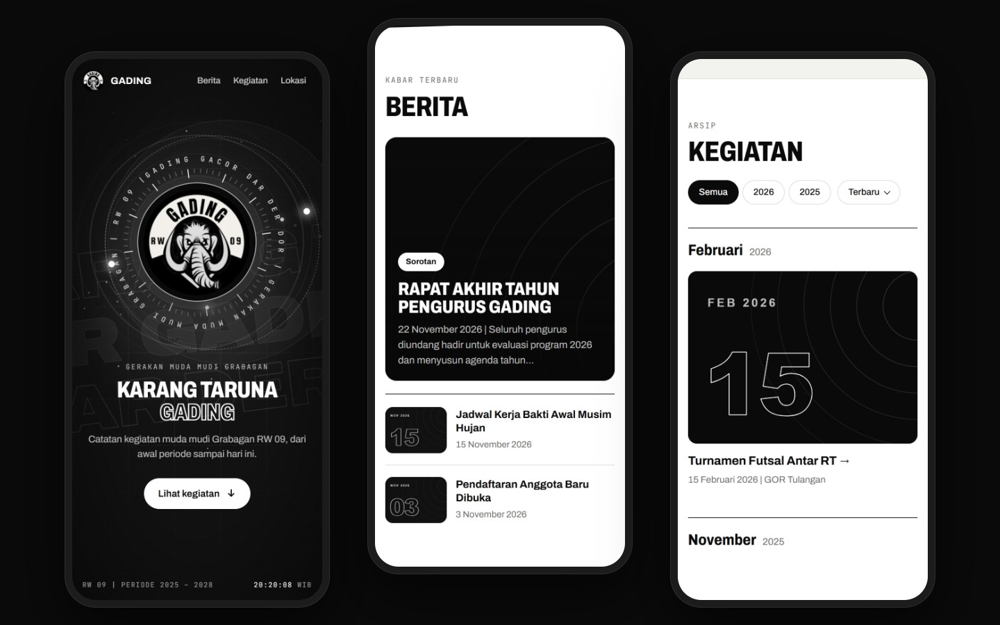
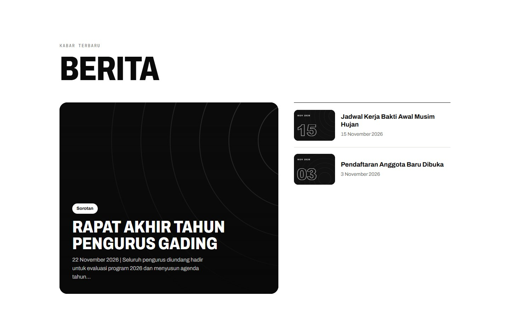
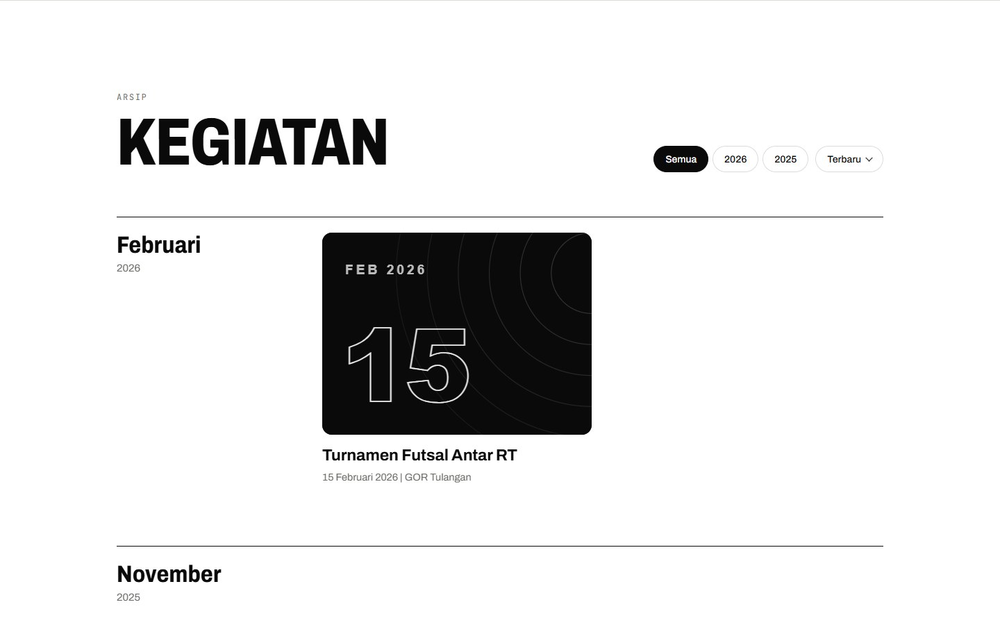
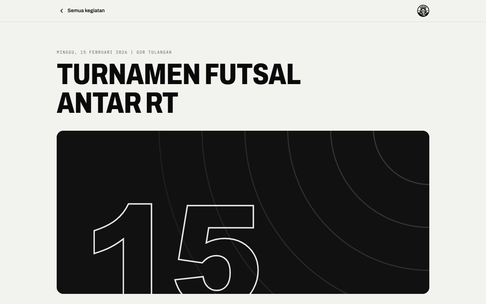
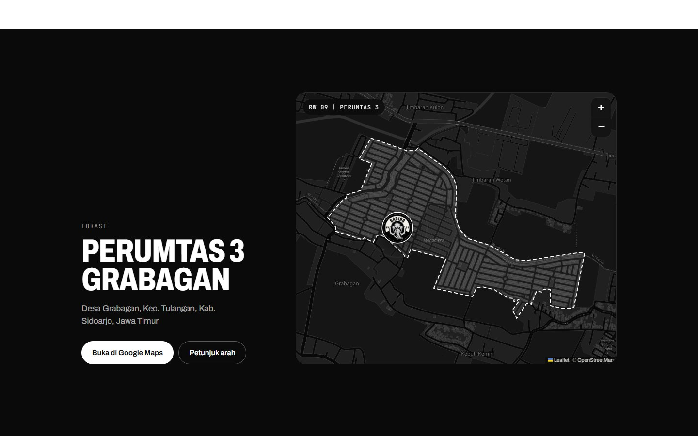
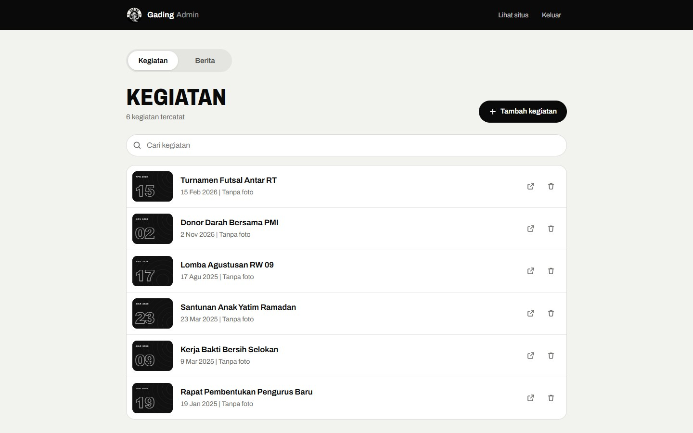
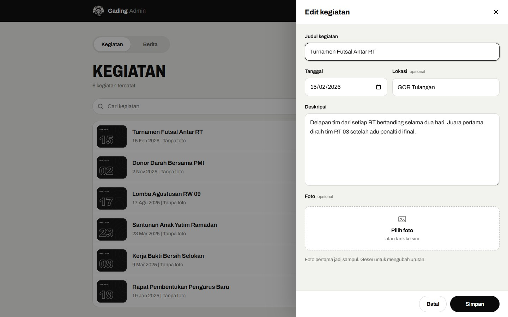

<div align="center">


# Karang Taruna GADING

**Gerakan Muda Mudi Grabagan | RW 09**<br>
Perumtas 3, Grabagan, Tulangan, Sidoarjo

`GADING GACOR DAR DER DOR`


</div>

<br>



<br>

Website arsip kegiatan dan berita Karang Taruna GADING. Semua kegiatan sejak awal periode tercatat di sini, lengkap dengan cerita dan fotonya. Pengurus mengisinya sendiri lewat panel admin, dan warga cukup membuka situsnya dari HP.

## Sorotan

| | |
|---|---|
| **Hero yang hidup** | Logo di tengah lingkaran: cincin dan teks melingkar yang berputar, partikel yang menghindari kursor, ledakan saat logo diketuk |
| **Berita** | Kabar terbaru di beranda, satu berita bisa dijadikan sorotan |
| **Arsip kegiatan** | Dikelompokkan per bulan, bisa difilter per tahun |
| **Galeri foto** | Lightbox layar penuh, bisa digeser di HP |
| **Peta wilayah** | Batas area Perumtas 3 di atas peta monokrom |
| **Panel admin** | Tambah, ubah, hapus. Foto dikompres otomatis sebelum diunggah |

## Tampilan



<table>
  <tr>
    <td width="50%"></td>
    <td width="50%"></td>
  </tr>
  <tr>
    <td></td>
    <td></td>
  </tr>
</table>

### Panel admin

<table>
  <tr>
    <td width="50%"></td>
    <td width="50%"></td>
  </tr>
</table>

<sub>Screenshot memakai data contoh.</sub>

## Dibangun dengan

- **HTML, CSS, JavaScript** murni, tanpa framework dan tanpa proses build
- **Supabase** untuk database, login admin, dan penyimpanan foto, dijaga Row Level Security
- **Leaflet + OpenStreetMap** untuk peta
- **Vercel** untuk hosting

<details>
<summary>Menjalankan sendiri</summary>

<br>

1. Jalankan server lokal di folder ini: `python -m http.server 5520`, lalu buka http://127.0.0.1:5520
2. Buat project Supabase, jalankan `supabase/schema.sql` di SQL Editor, lalu isi URL dan anon key di `js/config.js`
3. Buat user di Authentication, lalu daftarkan sebagai admin:
   ```sql
   insert into public.admin_users (user_id)
   select id from auth.users where email = 'email-admin@contoh.com';
   ```

Teks situs (nama, slogan, periode, alamat) semuanya ada di `js/config.js`.

</details>

<br>

<div align="center">
<sub>Dibuat untuk muda mudi Grabagan RW 09 | Data peta © OpenStreetMap contributors</sub>
</div>
